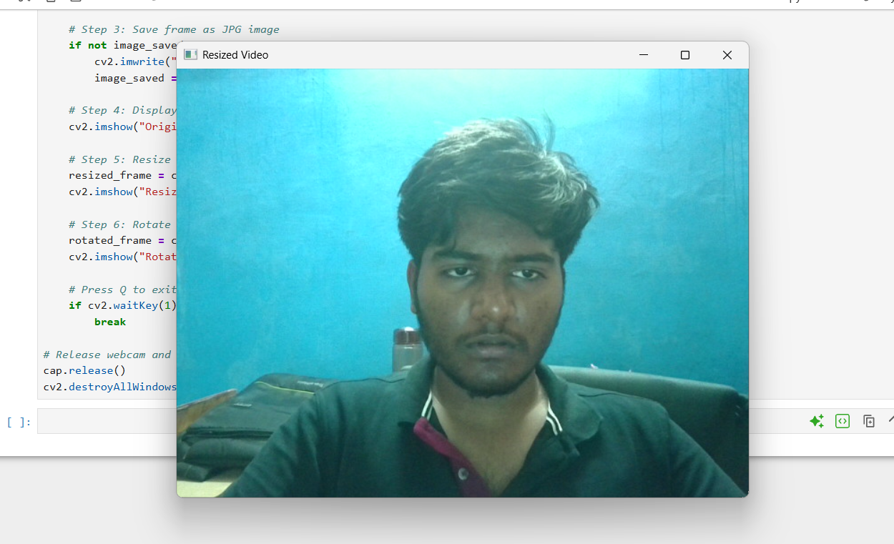
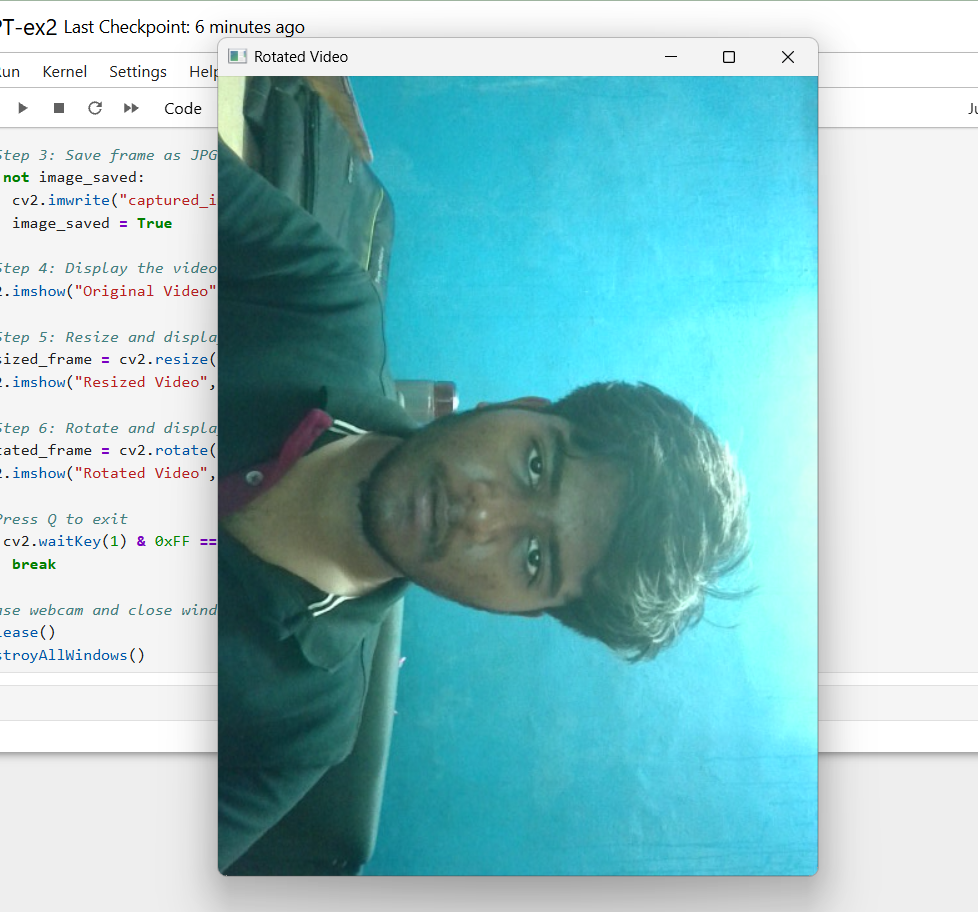

# Image Capture and Video Processing Using OpenCV

---

## Aim

To write a Python program using OpenCV to capture an image from the webcam and perform the following operations:

1. Write the frame as a JPG file  
2. Display the video  
3. Display the video by resizing the window  
4. Rotate and display the video  

---

## 🛠️ Software Used

- Anaconda – Python 3.7  
- Jupyter Notebook / VS Code  
- OpenCV (`cv2`)  

---

## ⚙️ Algorithm

### Step 1:
Import the required libraries and initialize the webcam using `cv2.VideoCapture()`.

### Step 2:
Capture frames continuously from the webcam.

### Step 3:
Save a frame as a JPG image using `cv2.imwrite()`.

### Step 4:
Display the live video stream using `cv2.imshow()`.

### Step 5:
Resize the frame and rotate it using OpenCV functions, then display the processed frames.

---

## 💻 Program
```
import cv2

# Step 1: Import library and initialize webcam
cap = cv2.VideoCapture(0)

if not cap.isOpened():
    print("Cannot access webcam")
    exit()

# Step 2: Capture frames continuously
image_saved = False

while True:
    ret, frame = cap.read()

    if not ret:
        print("Unable to capture frame")
        break

    # Step 3: Save frame as JPG image
    if not image_saved:
        cv2.imwrite("captured_image.jpg", frame)
        image_saved = True

    # Step 4: Display the video
    cv2.imshow("Original Video", frame)

    # Step 5: Resize and display the video (640 x 480)
    resized_frame = cv2.resize(frame, (640, 480))
    cv2.imshow("Resized Video", resized_frame)

    # Step 6: Rotate and display the video (90 degrees clockwise)
    rotated_frame = cv2.rotate(frame, cv2.ROTATE_90_CLOCKWISE)
    cv2.imshow("Rotated Video", rotated_frame)

    # Press Q to exit
    if cv2.waitKey(1) & 0xFF == ord('q'):
        break

# Release webcam and close windows
cap.release()
cv2.destroyAllWindows()
```

### Developed By:
**Name:** Eswar S

### Register No:
212225230067 

---

## Output

### i) Display the video
Live webcam video is displayed


### ii) Display the video by resizing the window
Video is shown in resized resolution (640 × 480)


### iii) Rotate and display the video
Video is displayed after rotation (90° clockwise)

---

## Result

Thus, the image is successfully captured from the webcam and various video processing operations such as saving, displaying, resizing, and rotating are performed using OpenCV.